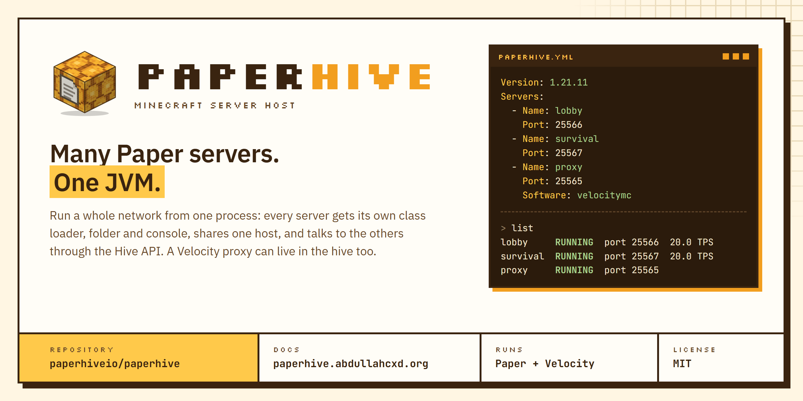

**Paperhive** runs a whole Minecraft network in one process: Paper servers (and a Velocity proxy) side by side, each
with its own class loader, folder and console, talking to each other through the Hive API.

[Repository](https://github.com/paperhiveio/paperhive) · [Documentation](https://paperhive.abdullahcxd.org) ·
[Releases](https://github.com/paperhiveio/paperhive/releases) · MIT licensed
